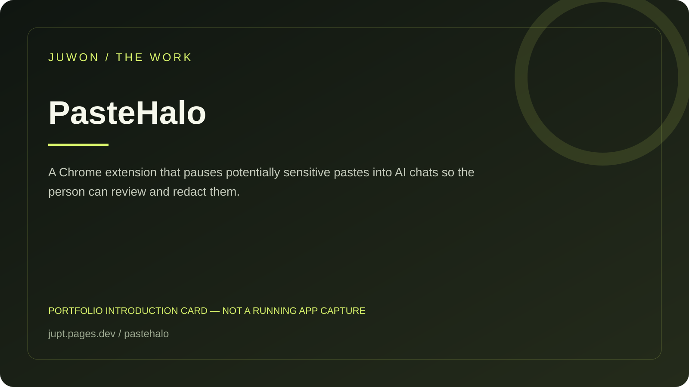

<!-- JUWON-PORTFOLIO-INTRO:START -->
# PasteHalo



*Portfolio introduction card, not a screenshot of a running application.*

*포트폴리오 소개 카드입니다. 실행 화면 캡처가 아닙니다.*

## English

A Chrome extension that pauses potentially sensitive pastes into AI chats so the person can review and redact them.

[View JUWON's portfolio](https://jupt.pages.dev/) · [Browse the project collection](https://jupt.pages.dev/projects)

**Scope:** This README presents the repository's documented intent and recorded visual evidence. It does not certify that every feature is complete, deployed, or currently working. Follow the original setup, safety, and license documentation below.

## 한국어

AI 채팅에 비밀값을 붙여넣기 전 멈추고 검토·가림을 제공하는 확장.

[JUWON 포트폴리오 보기](https://jupt.pages.dev/) · [전체 프로젝트 보기](https://jupt.pages.dev/projects)

**확인 범위:** 저장소의 문서상 목적과 기록된 화면 근거를 소개합니다. 모든 기능의 완성·배포·현재 정상 작동을 보증하지 않습니다. 설치법·안전 주의사항·라이선스는 아래 기존 문서를 확인하세요.
<!-- JUWON-PORTFOLIO-INTRO:END -->

---

## Original documentation / 기존 문서

# PasteHalo 🛡️

## See the secret before it enters your AI chat.

PasteHalo is a local, opt-in Chrome extension that pauses suspicious pastes before they reach ChatGPT, Claude, Gemini, support tools, or any other browser composer.

**Paste normally. Review once. Never send a secret by accident.**

```text
Enable on this tab  →  Paste  →  See what was found  →  Paste redacted / original once / cancel
```

No account. No cloud. No clipboard history. No telemetry. No automatic Send.

## Why this exists

AI tools make it easy to paste a log, `.env` fragment, stack trace, or configuration file. The dangerous part is often one line inside a large paste: a token that leaves the machine before anyone notices.

PasteHalo puts a small review at that exact moment. It does not watch the clipboard in the background and does not read the page until you explicitly enable it for the current tab.

## The five-second demo

1. Build PasteHalo.
2. Open an ordinary web page or AI chat.
3. Click the extension and choose **Enable on this tab**.
4. Paste this fake value:

   ```text
   OPENAI_API_KEY=sk-proj-123456789012345678901234
   ```

5. Choose **Paste redacted**. The page receives:

   ```text
   OPENAI_API_KEY=[REDACTED:secret-assignment]
   ```

The fake value is intentionally non-working example data. Never test with a real credential.

## Install from source

Requirements: Chrome 114+ and Node.js 20+.

```powershell
npm.cmd ci
npm.cmd run build
```

Then:

1. Open `chrome://extensions`.
2. Turn on **Developer mode**.
3. Choose **Load unpacked**.
4. Select this repository's `dist` directory.
5. Open a normal web tab, click PasteHalo, and choose **Enable on this tab**.

The extension uses `activeTab` and `scripting`, not permanent host access. Chrome internal pages and some protected pages will reject injection; PasteHalo reports that instead of pretending it is active.

## What it detects

- AWS access keys
- GitHub tokens
- Google API keys
- Slack tokens
- bearer tokens
- JWT-shaped values
- private-key blocks
- high-confidence secret-like assignments such as `API_KEY=...` or `password: ...`

Detectors are intentionally conservative. A detector is a warning, not proof that text is a live credential. Review every finding before choosing an action.

## Safety boundary

- **Local only:** detection and redaction run inside the page/extension bundle.
- **Explicit activation:** one click enables PasteHalo on one active tab.
- **No background clipboard watcher:** PasteHalo sees clipboard text only during a paste event on an enabled tab.
- **No page scraping:** it observes the paste target, not chat history or cookies.
- **No silent mutation:** suspicious pastes pause; you choose redacted text, original text once, or cancel.
- **No send:** PasteHalo never submits a form or clicks an AI chat's Send button.
- **No network code:** the extension has no API endpoint, account, analytics, or remote rule download.

Read [`SECURITY.md`](SECURITY.md) before loading the extension into a sensitive browser profile.

## Development

```powershell
npm.cmd ci
npm.cmd test
npm.cmd run typecheck
npm.cmd run lint
npm.cmd run build
npm.cmd audit --omit=dev
```

The source is intentionally small enough to audit. Start at [`src/detectors.ts`](src/detectors.ts), [`src/redact.ts`](src/redact.ts), and [`src/content.ts`](src/content.ts).

## Why open source?

The trust boundary is the product. People should be able to inspect exactly what is detected, what is replaced, which browser permissions are requested, and whether any network call exists before loading a paste guard.

## Product hypothesis

The first users are developers who paste logs and configuration into AI chats. The seven-day experiment is five fresh installs, each with three benign pastes and one seeded fake key. We will measure activation, false-positive complaints, redacted-choice rate, and second-day reuse. Stars are not proof of safety or adoption.

## License

MIT. See [`LICENSE`](LICENSE).
